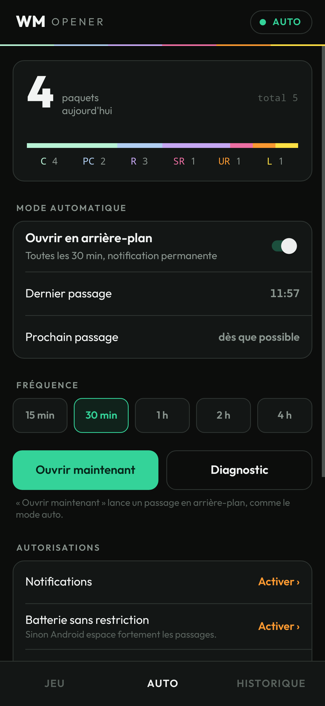
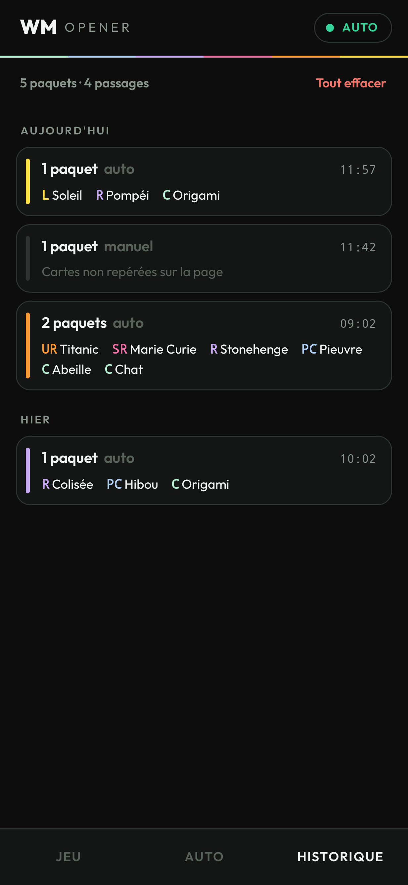

# WM Opener

Application Android qui ouvre automatiquement vos paquets de cartes sur wiki-masters.com, en arrière-plan.

*Les captures utilisent des données fictives.*

## Installation
1. Dans [Releases](../../releases), téléchargez le fichier `WM_Opener-vX.Y.Z.apk`.
2. Ouvrez-le sur le téléphone et autorisez l'installation depuis cette source.

## Premier lancement
1. Onglet **Jeu** : connectez-vous. Le captcha empêche toute connexion automatique ; la session est ensuite conservée.
2. Onglet **Auto**, rubrique *Autorisations* : activez les notifications et la batterie sans restriction.
3. Lancez **Diagnostic** : l'appli liste les boutons de la page des paquets, en marquant `OUVRIR`, `SUITE` ou `✕` (jamais cliqué).
   Si le bouton d'ouverture n'est pas marqué `OUVRIR`, corrigez-le dans *Avancé → Détection des boutons*.
4. Essayez **Ouvrir maintenant**, puis activez le mode automatique.

## Fonctionnement
- À chaque passage (toutes les 10 min à 4 h), une page invisible charge `/pulls` et exécute `app/src/main/assets/opener.js`.
  Le script clique « ouvrir », puis « révéler / continuer… », et recommence jusqu'au maximum réglé.
- Une notification permanente reste affichée tant que le mode automatique est actif. Pendant chaque ouverture, elle cède
  la place à une notification de progression non effaçable.
- L'**Historique** garde chaque passage qui a ouvert au moins un paquet, avec les cartes repérées. Un appui long supprime
  une entrée ; « Tout effacer » vide l'historique.

## Sécurité
- Ne clique jamais un bouton qui évoque un achat, une monnaie premium ou une publicité. Si une expression est invalide,
  rien n'est cliqué.
- La WebView reste sur wiki-masters.com : les autres liens s'ouvrent dans le navigateur, et le pont JavaScript ignore
  tout autre domaine.
- Les données (dont les cookies de session) sont exclues des sauvegardes Android.

## Limites
- Les libellés des boutons de `/pulls` n'ont pas pu être vérifiés (page réservée aux comptes connectés).
- La détection des cartes est approximative : elle repose sur la structure HTML observée sur la page d'accueil.
- Android impose 15 min minimum entre deux passages et peut les retarder en économie d'énergie.
- Les règles du site (§3) interdisent l'automatisation : le compte peut être sanctionné.

## Développement
Voir `CLAUDE.md` pour l'architecture, le build et la procédure de release.
